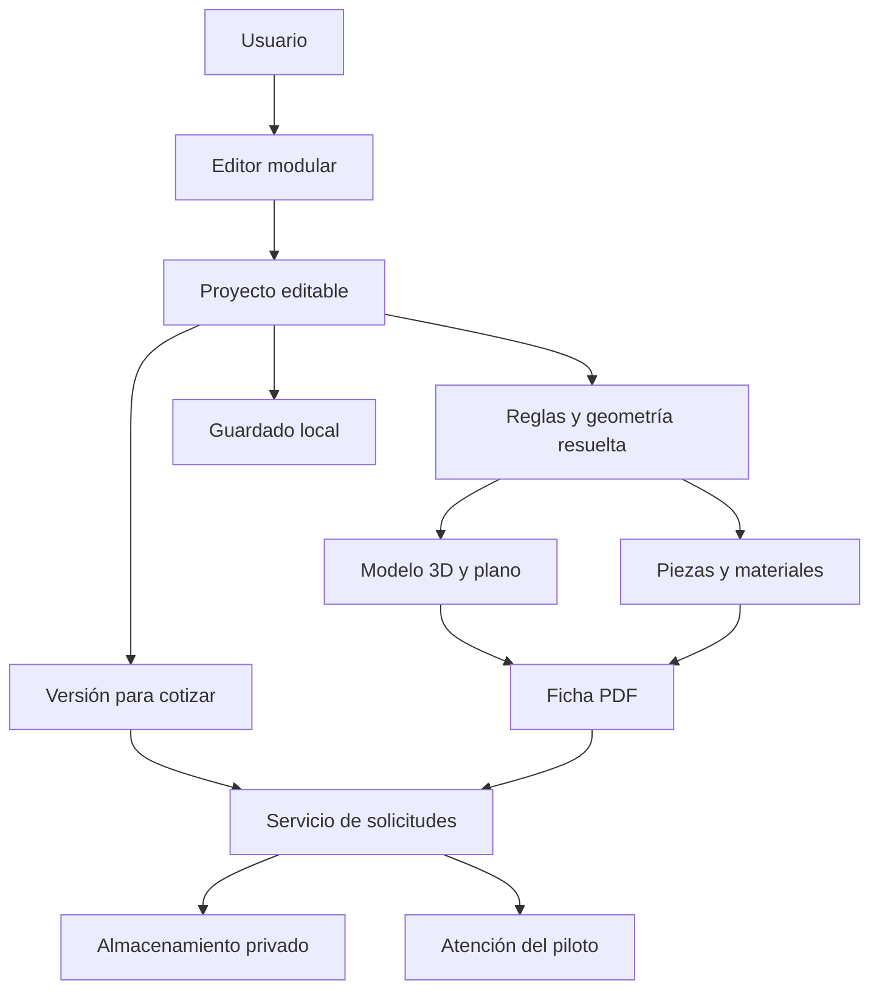
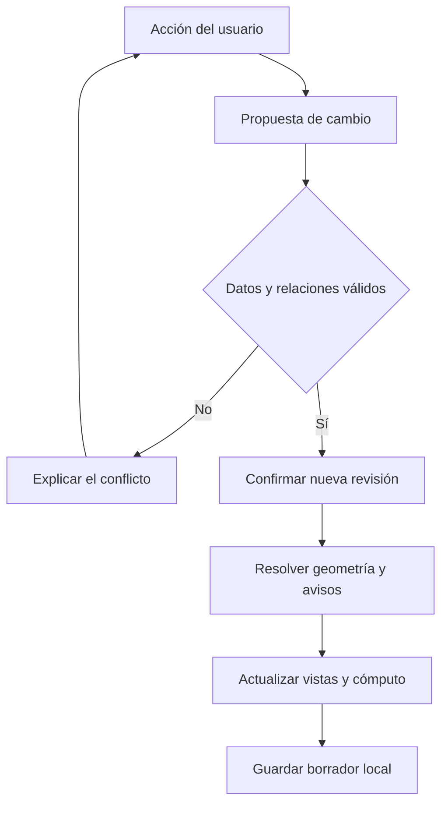
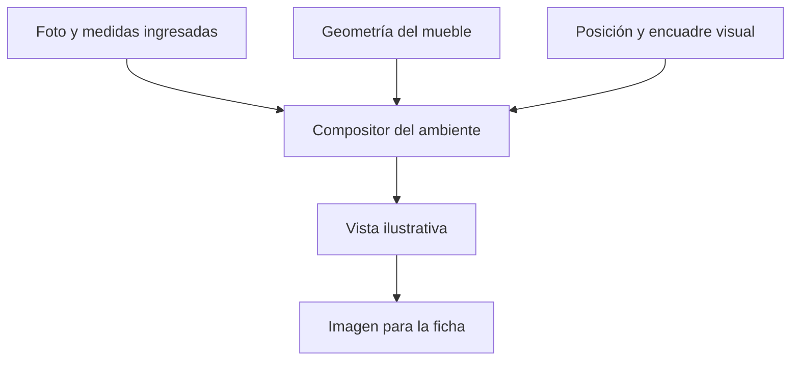
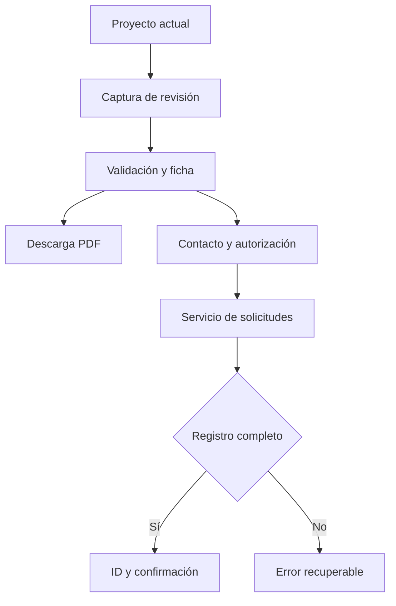

# Flujo de arquitectura
## Plataforma web para crear y cotizar muebles a medida

**Código:** DOC-04A  
**Versión:** 0.2  
**Fecha:** 4 de noviembre de 2026  
**Estado:** Arquitectura propuesta para el MVP; pendiente de POC.  
**Bases:** DOC-01 y DOC-02, contenido V0.2, y modelos visuales conceptuales.  
**Stack definido por el equipo:** `tecnologias.md` (React + React Three Fiber + `<model-viewer>`; Spring Boot 4.x monolito modular; MySQL).  
**Alineación (12/11/2026):** hay puntos de alcance que difieren de lo ya definido por el equipo. Ver `doc/coherencia_y_decisiones.md`.  

## 1. Objetivo y decisión central

Definir cómo se conectan el editor modular, el modelo 3D, la visualización del ambiente, el plano, el cómputo, el PDF y la solicitud de presupuesto.

El proyecto editable será la fuente común de datos: piezas, medidas, materiales y relaciones. El modelo 3D, las vistas y el cómputo serán resultados derivados. La foto y la colocación visual no modificarán las dimensiones reales del mueble.

Este documento establece responsabilidades y flujos. Los programas, bibliotecas y proveedores se elegirán en DOC-04B. No describe funciones ya implementadas.

## 2. Organización general

Se propone una aplicación web con un editor que funciona en el navegador y un servicio pequeño para registrar solicitudes y conservar sus archivos. El motor de reglas será un módulo reutilizable del mismo proyecto, no un servicio separado. No se requieren microservicios, un portal completo de profesionales ni cuentas de cliente para la primera prueba.

El guardado local sirve para continuar en el mismo navegador. El almacenamiento del servidor conserva las solicitudes enviadas. Registrar una solicitud no equivale a que el carpintero la haya leído o presupuestado.

## 3. Componentes y responsabilidades

| Componente | Responsabilidad | Límite |
| --- | --- | --- |
| Interfaz del editor | Paletas, selección, medidas, mover, duplicar, eliminar y deshacer/rehacer. | No calcula piezas de forma independiente. |
| Estado del proyecto | Conservar datos editables, revisión y referencias de elementos. | No usa las mallas 3D como registro principal. |
| Catálogo modular | Definir elementos permitidos, parámetros y reglas compatibles. | Una miniatura no implica que el módulo esté implementado. |
| Motor de reglas | Resolver posiciones dependientes, validar datos, producir geometría y avisos. | No certifica estabilidad ni fabricación. |
| Visor 3D | Representar la geometría resuelta y permitir inspección. | La cámara no cambia dimensiones. |
| Compositor del ambiente | Mostrar la foto y situar visualmente el mueble. | No obtiene medidas automáticamente. |
| Generador de plano | Proyectar frente, planta y lateral y agregar cotas. | No interpreta una imagen generada por IA. |
| Generador de cómputo | Enumerar piezas y aplicar reglas de cantos y herrajes conocidas. | No supone cantidades cuando faltan reglas. |
| Generador PDF | Reunir resultados de una misma revisión y sus advertencias. | No mezcla vistas antiguas con datos nuevos. |
| Servicio de solicitudes | Validar, registrar una versión enviada y devolver un identificador. | No realiza contratación ni pagos. |
| Atención del piloto | Permitir revisión controlada y respuesta manual del operador o carpintero autorizado. | No exige construir un marketplace. |

## 4. Estructura mínima del proyecto

| Dato | Contenido previsto |
| --- | --- |
| Identificación | ID local, nombre, fechas y revisión del proyecto. |
| Compatibilidad | Versión del formato, del catálogo y de las reglas utilizadas. |
| Elementos | ID único, tipo, parámetros, material, orientación y posición de referencia. |
| Relaciones | Elementos vinculados, caras o referencias de colocación, separación y regla aplicable. |
| Materiales | Identificador, espesor y acabado; propiedades requeridas por las reglas. |
| Ambiente | Referencia a la foto, dimensiones ingresadas y observaciones del usuario. |
| Colocación visual | Encuadre y transformación usada sobre la foto; independiente de medidas constructivas. |
| Presentación | Cámara y preferencias de visualización. No afecta al cómputo. |

Los datos personales se solicitan al pedir presupuesto; no son necesarios para crear el mueble. Una solicitud contendrá contacto, destinatario, autorización de envío, fecha, versión del proyecto, estado y archivos asociados.

### Convenciones de medidas

Se propone guardar longitudes en milímetros, con resolución inicial de 1 mm. La interfaz podrá mostrar centímetros y convertirá las entradas una sola vez. Esta precisión es una convención digital, no una tolerancia de fabricación.

El origen del mueble estará en la esquina frontal izquierda de su envolvente inferior: X hacia la derecha, Y hacia el fondo y Z hacia arriba. Cada pieza tendrá ejes locales para largo, ancho y espesor; su orientación los relacionará con los del mueble. La POC usará tableros ortogonales y orientaciones controladas.

Frente corresponde a la proyección X–Z, planta a X–Y y lateral a Y–Z. La envolvente de la geometría resuelta determinará las medidas generales. Aumentar el zoom o la escala sobre la foto no cambiará estas medidas.

## 5. Paletas y relaciones

La paleta mínima propuesta incluye tablero, lateral y estante. Una paleta separada reúne materiales y acabados. Puertas, cajones y patas se incorporarán cuando se definan sus parámetros, relaciones y reglas; las imágenes conceptuales no cierran esta decisión.

Una plantilla opcional será un proyecto inicial compuesto por los mismos elementos editables. Comenzar desde cero y desde plantilla utilizará el mismo motor.

Para evitar que mover piezas sea solo una superposición visual, el editor permitirá vincularlas mediante referencias. Por ejemplo: un estante entre dos laterales, con una altura definida y una profundidad compatible. Su ancho podrá depender de la distancia interior entre las caras de los laterales.

Cada parámetro será independiente o calculado por una relación, sin dos fuentes contradictorias. Las dependencias cíclicas se rechazarán en el MVP; no se necesita un solucionador CAD general. Si un cambio rompe una relación, la aplicación lo señalará antes de confirmarlo o pedirá resolverla explícitamente.

Duplicar asignará IDs nuevos y conservará únicamente relaciones que sigan siendo válidas. Al eliminar un elemento con dependientes, se mostrará qué relaciones se perderán y se permitirá cancelar o continuar dejando esos vínculos pendientes. Deshacer restaurará también relaciones y medidas.

## 6. Flujo de una edición

Durante un arrastre puede existir una vista temporal. Al confirmar se actualiza la revisión. Los resultados llevarán el número de revisión que los produjo; si llega un cálculo antiguo después de uno nuevo, se descartará. Mientras falte actualizar un resultado no se exportará como si fuera actual.

El historial de deshacer será acotado y local a la sesión. Su profundidad y los límites de piezas se fijarán en la POC según rendimiento, sin prometer capacidad ilimitada.

## 7. Validaciones y estados del diseño

| Nivel | Ejemplos | Comportamiento |
| --- | --- | --- |
| Error de datos | Dimensión no positiva, material inexistente, referencia rota o ciclo. | No aceptar la operación inválida ni generar una ficha normal. |
| Diseño incompleto | Pieza sin vinculación definida o herraje pendiente. | Permitir continuar y exportar una referencia marcada como incompleta. |
| Aviso geométrico | Solapamiento detectado o dimensión fuera del límite acordado. | Identificar elementos y problema; evitar mostrar estado resuelto. |
| Revisión profesional | Estabilidad, uniones, fijaciones, transporte e instalación. | Mantener pendiente de revisión incluso si no hay avisos digitales. |

Un contacto previsto entre caras no se tratará como una colisión. Las tolerancias de detección se definirán en la POC. La ausencia de interferencias no demuestra estabilidad o viabilidad constructiva.

Una ficha incompleta podrá enviarse como consulta para revisión si el usuario conoce sus pendientes y estos acompañan la solicitud. Los datos corruptos o referencias imposibles deberán corregirse antes de enviar.

## 8. Plano y cómputo

El plano se derivará de la geometría resuelta mediante proyecciones ortográficas. Incluirá vistas de frente, planta y lateral, unidades, dimensiones generales, fecha y revisión. La representación de líneas ocultas y cotas por pieza se acotará en la POC; no se confundirá un plano de referencia con documentación de taller.

Cada pieza física tendrá una entrada identificable. Las piezas equivalentes podrán agruparse conservando la relación con sus IDs, material, espesor y orientación de acabado cuando corresponda.

Los cantos se obtendrán de los bordes definidos para recibir terminación. Los herrajes se contarán solo cuando exista una regla de unión o módulo validada. Si todavía no existe, se informará como pendiente. Un conjunto como un cajón se descompondrá en sus piezas una sola vez: la visualización del conjunto no agregará una segunda cantidad.

Las dimensiones iniciales serán nominales de diseño. Descuentos por uniones, correderas o cantos solo se aplicarán mediante reglas documentadas. La compra de placas, optimización de cortes, desperdicio y precio final quedan fuera de esta versión.

## 9. Visualización del ambiente

La foto se procesa como referencia visual. El usuario ajusta posición, orientación y tamaño aparente con controles separados de los de edición del mueble. Las medidas ingresadas se conservan como restricciones declaradas; no calibran automáticamente la perspectiva de la cámara.

La POC deberá demostrar si un encuadre manual resulta suficiente y comprensible. Oclusión por muebles existentes, sombras realistas y reconstrucción del ambiente no se garantizan en el MVP. Una futura imagen asistida por IA conservará su carácter ilustrativo y no alimentará el plano ni el cómputo.

## 10. Guardado y recuperación

El borrador se guardará en el almacenamiento del navegador, incluida la referencia local de la foto cuando el mecanismo elegido lo permita. Se mostrará el estado real: guardado, pendiente o error. Cerrar y abrir en el mismo navegador deberá recuperar el último borrador guardado.

Este mecanismo no garantiza conservación si el usuario borra datos del navegador o cambia de dispositivo. No se presentará como guardado en una cuenta. Las cuotas, recuperación tras fallos y la necesidad de un archivo editable exportable se resolverán en DOC-04B y la POC.

El PDF es una representación del proyecto, no su formato editable. Las solicitudes enviadas se conservarán en el servidor independientemente del borrador local.

## 11. Exportación y solicitud de presupuesto

Al descargar o enviar se captura una copia fija de la revisión actual. La geometría, el plano, el cómputo, los avisos y las imágenes del PDF deben corresponder a esa misma copia. El usuario puede seguir editando después sin alterar lo enviado.

El servicio comprobará el formato, los límites, el destinatario y los datos requeridos. Volverá a validar y calcular las piezas con la misma versión de reglas; rechazará discrepancias relevantes en vez de confiar únicamente en cantidades enviadas por el navegador. La generación del PDF puede ejecutarse en el navegador, pero el servidor conservará el documento junto con los datos revisados de su misma captura. Ninguna de estas comprobaciones certifica fabricación.

La solicitud se marcará como registrada solo después de conservar su captura y archivos obligatorios. Se devolverá un ID. Si la respuesta de red se pierde, un reintento con la misma clave de envío recuperará el registro existente en lugar de crear otro. Si cambia el contenido, se utilizará un envío nuevo. No se eliminarán automáticamente pedidos distintos del mismo usuario.

El piloto tendrá una ruta real de atención mediante una vista protegida sencilla o un procedimiento manual controlado, a definir en DOC-04B. Una notificación por correo será opcional; el registro no dependerá de que un correo llegue. La aplicación no afirmará que un presupuesto fue emitido por el solo hecho de registrar el pedido.

## 12. Estados de la solicitud

| Estado | Significado |
| --- | --- |
| Enviando | Intento en curso; todavía sin confirmación de registro. |
| Registrada | El servidor conservó datos y archivos necesarios y devolvió ID. |
| En revisión | El operador o profesional comenzó a revisarla. |
| Requiere aclaración | Se necesita información adicional del cliente. |
| Respondida | Se registró una respuesta comercial enviada por el canal acordado. |
| Cerrada o cancelada | Finalizó la atención o se canceló con motivo. |

El error de envío se mostrará en la interfaz como resultado del intento, no como una solicitud registrada. En el MVP los cambios comerciales podrán gestionarse manualmente. Respondida no significa aceptada, contratada ni fabricada.

## 13. Archivos, acceso y datos personales

- Validar tipo y tamaño de imágenes y PDF; límites concretos pendientes de POC.
- Conservar fotos y documentos de solicitudes en almacenamiento privado, con acceso solo de los responsables autorizados. Un ID no será por sí solo una credencial de acceso.
- Mostrar al usuario el destinatario y qué información compartirá antes del envío. Registrar autorización y versión del aviso.
- Enviar la foto original solo si está incluida expresamente; permitir que el usuario revise la imagen que acompañará el pedido.
- Mantener credenciales de servidor o proveedores fuera del código entregado al navegador.
- Aplicar límites básicos de solicitudes para reducir abuso del formulario; detalles en DOC-04B.
- Definir plazo de conservación y procedimiento de eliminación antes del piloto; no se fija una retención indefinida por defecto.

## 14. Fallos previstos

| Situación | Resultado esperado |
| --- | --- |
| Foto no admitida o excesiva | Explicación y posibilidad de elegir otra, conservando el mueble. |
| Cambio que rompe una relación | Explicar dependientes y permitir cancelar o resolver. |
| Guardado local no disponible | Avisar; no mostrar confirmación falsa de guardado. |
| Visor 3D incompatible | Mostrar limitación real y conservar datos; no prometer edición alternativa aún no implementada. |
| Generación de PDF fallida | Mantener revisión y permitir reintentar sin producir un archivo incompleto como válido. |
| Envío sin conexión | Conservar el borrador y permitir reintentar; no confirmar registro. |
| Respuesta perdida tras registrar | Recuperar el mismo ID mediante la clave de envío. |
| Archivo obligatorio no conservado | No confirmar solicitud completa; permitir recuperación del intento. |
| Reglas incompatibles con un proyecto guardado | Identificar versión y pedir actualización controlada, sin reinterpretarlo silenciosamente. |

## 15. POC que debe comprobar esta arquitectura

1. Crear desde una paleta común al menos dos tipologías sencillas, sin lógica exclusiva de escritorio.
2. Modificar, duplicar y eliminar piezas; comprobar relaciones, historial y recálculo.
3. Comparar dimensiones del modelo, vistas, piezas y PDF sobre una misma revisión.
4. Mover y escalar la implantación sin modificar medidas ni cantidades del mueble.
5. Identificar un diseño incompleto y conservar sus avisos al exportar y enviar.
6. Recuperar un borrador local y registrar una solicitud con sus archivos.
7. Reintentar el mismo envío y comprobar que devuelve un único registro.
8. Editar después de enviar y comprobar que la solicitud anterior conserva su versión.

Los límites de rendimiento, tolerancias, dispositivos, fechas y condiciones medibles se fijarán en DOC-06. Las pruebas de comprensión y utilidad seguirán el protocolo de DOC-02.

## 16. Decisiones que pasan al documento 04B

| Decisión | Orientación establecida aquí |
| --- | --- |
| Interfaz y visor | Aplicación web con edición modular en el navegador. |
| Reglas y geometría | Módulo común reutilizable en navegador y servidor. |
| Plano y PDF | Generación determinista desde una revisión; herramientas por elegir. |
| Persistencia local | Recuperación en el mismo navegador sin cuenta obligatoria. |
| Servicio y almacenamiento | Un servicio pequeño, registros y archivos privados. |
| Operación del piloto | Ruta protegida o procedimiento controlado para revisar y responder. |
| IA | Opcional y posterior; fuera del cálculo dimensional. |
| Cuentas, límites y proveedores | Selección en 04B según POC, presupuesto y plazo. |

## 17. Historial

| Versión | Fecha | Cambio |
| --- | --- | --- |
| 0.1 | 04/11/2026 | Arquitectura inicial para editor modular, visualización, documentación y solicitudes del MVP. |
| 0.2 | 12/11/2026 | Referencia al stack definido. Diferencias de alcance (cuentas, panel de carpintería, WhatsApp, AR) señaladas en `coherencia_y_decisiones.md`. |
