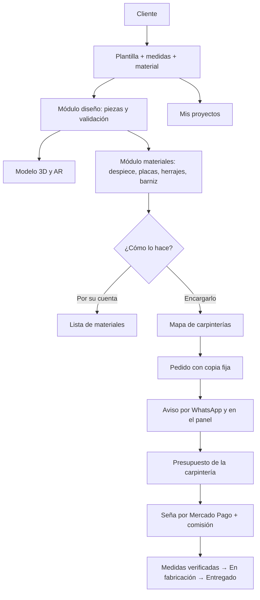
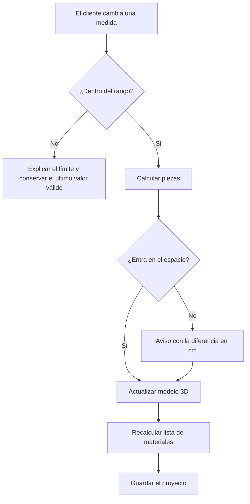
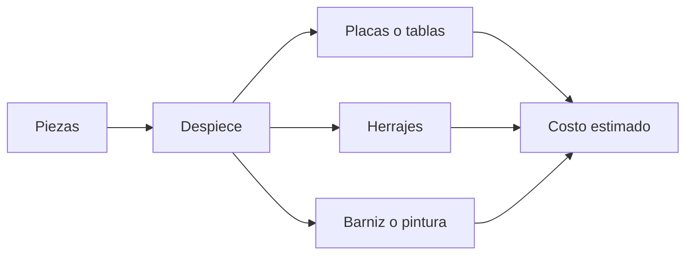
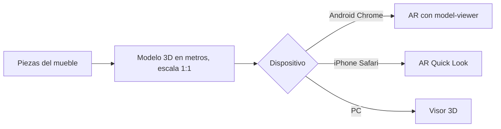
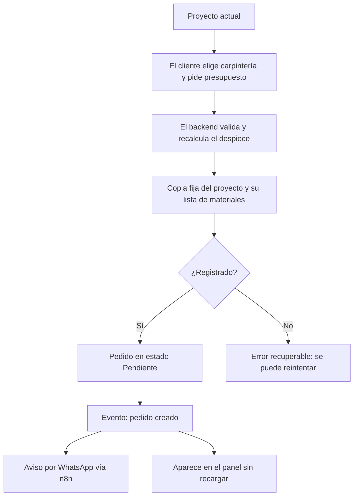
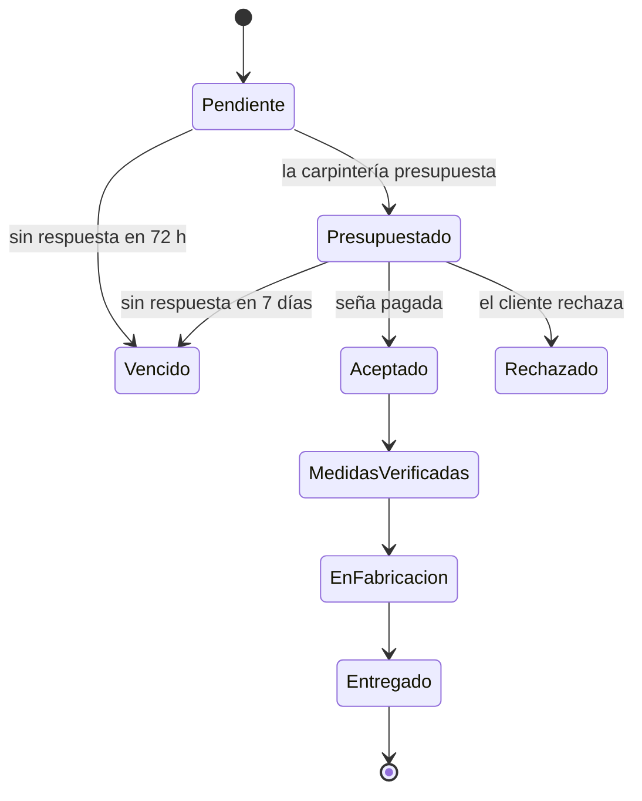
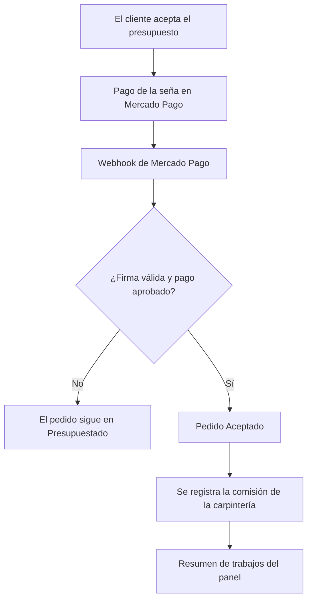

# Flujo de arquitectura
## Viruta – plataforma web para diseñar, visualizar y encargar muebles a medida

**Código:** DOC-04A
**Versión:** 0.3
**Fecha:** 13 de noviembre de 2026
**Estado:** Propuesto. Pendiente de aprobación del equipo.
**Bases:** DOC-01 V0.4, DOC-02A y DOC-02B V0.3, `tecnologias.md`.
**Stack:** frontend React + React Three Fiber + `<model-viewer>` (Vercel) · backend Java + Spring Boot 4.x, monolito modular · MySQL · Docker · Google Maps, n8n (WhatsApp), Mercado Pago.

---

## 1. Objetivo y decisión central

Describir el ciclo completo, desde que el cliente elige una plantilla hasta que la carpintería entrega el mueble, y qué datos pasan de un paso al otro.

**Decisión central:** el **proyecto** (plantilla, medidas, material, color y medidas del espacio) es la única fuente de datos. El modelo 3D, la vista en AR, el despiece y la lista de materiales se calculan a partir de él. Al pedir presupuesto se guarda una **copia fija** del proyecto, que es lo que ve la carpintería.

Los detalles técnicos de cada integración van en DOC-04B.

## 2. Organización general

Una sola aplicación web con dos interfaces (cliente y carpintería) y un backend **monolito modular**. Cada módulo se comunica con los demás solo por interfaces públicas o eventos, para poder separarlo más adelante (RNF-06, RNF-07).

## 3. Componentes y responsabilidades

### Frontend (React, en Vercel)

| Componente | Responsabilidad | Límite |
|---|---|---|
| Editor de plantillas | Elegir plantilla y ajustar medidas, estantes, material y color. | No calcula el despiece: lo pide al backend. |
| Visor 3D (React Three Fiber) | Dibujar el mueble y permitir girarlo. | La cámara no cambia medidas. |
| Vista AR (`<model-viewer>`) | Mostrar el mueble a escala real en el espacio. En PC, visor 3D. | No mide el espacio. |
| Lista de materiales | Mostrar despiece, placas, herrajes, barniz y costo, marcados como estimados. | — |
| Mapa de carpinterías | Mostrar las carpinterías cercanas que trabajan el material elegido. | — |
| Mis pedidos | Ver presupuestos, aceptar, pagar la seña y seguir el estado. | — |
| Panel de la carpintería | Bandeja, detalle del pedido, presupuesto, estados y resumen. Mobile first. | Solo ve sus pedidos. |
| Lista de espera y panel interno | Inscripción con contador y métricas de tracción. | Los números salen de la base de datos. |

### Backend (Spring Boot, monolito modular)

| Módulo | Responsabilidad | Patrón |
|---|---|---|
| `usuarios` | Registro, inicio de sesión, roles Cliente y Carpintería, JWT. | — |
| `diseño` | Plantillas y sus rangos, validación de medidas, comparación con el espacio, piezas del mueble y proyectos guardados. | — |
| `materiales` | Despiece, placas, herrajes, barniz y costo estimado. | Strategy por material |
| `carpinterías` | Perfil, zona, WhatsApp, materiales y búsqueda por material y cercanía. | Adapter (Google Maps) |
| `pedidos` | Pedido con copia fija, presupuesto y estados. | State |
| `pagos` | Seña por Mercado Pago, confirmación por webhook y comisión. | Adapter (Mercado Pago) |
| `notificaciones` | Aviso por WhatsApp y actualización en tiempo real del panel. | Eventos de dominio, Adapter (n8n) |

## 4. Datos principales

| Dato | Contenido |
|---|---|
| Proyecto | Cliente, plantilla, medidas del mueble, cantidad de estantes, material, espesor, color, medidas del espacio y número de revisión. |
| Pieza | Derivada del proyecto: nombre, largo, ancho, espesor y cantidad. |
| Lista de materiales | Derivada de las piezas: placas, herrajes, barniz y costo, todo marcado como estimado, con la fecha de los precios de referencia. |
| Carpintería | Nombre, zona, WhatsApp, materiales con los que trabaja y ubicación del taller. |
| Pedido | Copia fija del proyecto y de su lista de materiales, cliente, carpintería, estado, fechas y clave de envío. |
| Presupuesto | Materiales, mano de obra e indicación de si el cliente compra el material. |
| Pago | Seña, estado informado por Mercado Pago y comisión calculada. |
| Inscripto | Lista de espera: tipo (cliente o carpintería) y fecha. |

Los datos personales del cliente se piden recién al pedir presupuesto; no hacen falta para diseñar (RNF-09).

### Convención de medidas

- Todas las longitudes se guardan en **milímetros enteros** (RNF-01). La interfaz puede mostrar centímetros y convierte una sola vez.
- El origen del mueble está en la esquina frontal izquierda inferior: X hacia la derecha, Y hacia el fondo y Z hacia arriba.
- Las medidas generales del mueble salen de sus piezas. Girar la cámara, hacer zoom o mover el mueble en AR no las cambia.

## 5. Plantillas paramétricas

Cada plantilla (estante, mesa, bajo mesada) define:

- Sus parámetros: ancho, alto, profundidad y cantidad de estantes cuando corresponde.
- El rango permitido de cada parámetro.
- Cómo se calculan sus piezas a partir de los parámetros y el espesor del material. Por ejemplo, en el estante, el ancho de los estantes interiores es el ancho total menos dos espesores.

Solo se aceptan valores dentro del rango (RF-01). Agregar una plantilla nueva no debería obligar a tocar los otros módulos (RF-26).

## 6. Flujo de una edición

El modelo 3D se actualiza en menos de 1 segundo (RF-01). Cada resultado lleva el número de revisión que lo produjo: si llega un cálculo viejo después de uno nuevo, se descarta.

## 7. Validaciones

| Caso | Ejemplo | Comportamiento |
|---|---|---|
| Medida inválida | Cero, negativa o fuera del rango de la plantilla. | No se acepta; se conserva el último valor válido. |
| No entra en el espacio | El mueble es más ancho, alto o profundo que el espacio. | Aviso con la diferencia en cm (RF-02). |
| Medidas inconsistentes | Profundidad adelante distinta de la de atrás. | Se usa la menor y se avisa (RF-02). |
| Verificación profesional | Medidas reales, uniones, instalación. | La carpintería verifica en el lugar antes de fabricar (estado *Medidas verificadas*). |

## 8. Cálculo de materiales

- **Despiece:** cada pieza con medidas en mm y cantidad; la suma coincide con el modelo (RF-07).
- **Placas:** según el tamaño estándar del material (por ejemplo, 2400 × 1800 mm). Cálculo simple: cuántas piezas entran por placa y redondeo hacia arriba. No optimiza cortes (RF-08).
- **Herrajes y terminación:** tornillos, bisagras o correderas y litros de barniz o pintura, con su unidad (RF-09).
- **Costo:** solo si hay precios de referencia con fuente y fecha; siempre marcado como estimado (RF-10).

Todo el cálculo vive en el módulo `materiales` del backend. Es lógica pura y se prueba con casos fijos (DOC-06 §5).

## 9. Visualización en el espacio (AR)

- El modelo para AR se genera desde las mismas piezas, convertido de mm a metros.
- Pesa menos de 5 MB y abre en menos de 3 segundos con 4G (RNF-04).
- La AR muestra cómo queda el mueble; no mide ni corrige las medidas cargadas.

## 10. Guardado

Los proyectos se guardan en MySQL y se ven en "Mis proyectos" (RF-05). Reabrir un proyecto recupera las mismas medidas, material y color.

Si el cliente necesita o no una cuenta antes de pedir presupuesto está pendiente (DOC-05 §15).

## 11. Pedido de presupuesto

- El backend vuelve a calcular el despiece con el módulo `materiales`; no confía en las cantidades que manda el navegador.
- La copia fija no cambia si el cliente edita el proyecto después.
- Cada envío lleva una **clave de envío**: si se reintenta por un corte de red, se recupera el mismo pedido en lugar de crear otro.
- El aviso por WhatsApp es solo un aviso. Si falla, se reintenta, y el pedido igual queda en la bandeja del panel (RF-16).

## 12. Estados del pedido

La máquina de estados es la de DOC-02A:

Cualquier estado anterior a *Entregado* puede pasar a *Cancelado*. Solo la carpintería del pedido cambia los estados de *Aceptado* en adelante, y siempre en este orden (RF-19).

## 13. Cobro de la seña y comisión

- El pedido pasa a *Aceptado* **solo** cuando el webhook confirma el pago, con la firma verificada (RF-18, RNF-08).
- La comisión se calcula con el porcentaje configurado (8% a 12%).
- Los montos del resumen coinciden con los pagos confirmados (RF-30).
- Si no se llega con la integración, el primer pedido real se cobra con un link de pago generado a mano (DOC-05 §9).

## 14. Acceso, seguridad y datos personales

- JWT con autorización por rol: un cliente no puede ver la bandeja de una carpintería y una carpintería solo ve sus pedidos (RF-12).
- Contraseñas con BCrypt, solo HTTPS, validación de toda entrada, OWASP Top 10 y límite de peticiones en el inicio de sesión (RNF-08).
- El repositorio es público: ninguna clave en el código, todo en `.env` ignorado por git.
- El WhatsApp de la carpintería se usa solo para pedidos, y el cliente ve la dirección exacta del taller recién al aceptar el presupuesto (RNF-09).
- Consentimiento explícito y posibilidad de borrar la cuenta (Ley 25.326).
- Conocer el ID de un pedido no alcanza para verlo: siempre se verifica el usuario.

## 15. Fallos previstos

| Situación | Resultado esperado |
|---|---|
| Google Maps no responde | El cliente sigue diseñando y viendo materiales; el mapa muestra el error (RNF-11). |
| n8n o WhatsApp fallan | Se reintenta; el pedido queda igual en el panel. |
| Mercado Pago no confirma | El pedido sigue en *Presupuestado*; no se muestra como aceptado. |
| Se pierde la respuesta al enviar un pedido | El reintento con la misma clave devuelve el mismo pedido. |
| El celular no soporta AR | Se muestra el visor 3D. |
| Medida fuera de rango | Se explica el límite y se conserva el último valor válido. |

Todas las integraciones tienen tiempo máximo de espera y reintentos (RNF-11).

## 16. Pruebas

Los casos de referencia y las matrices de aceptación están en DOC-06. Salen de los criterios de aceptación de DOC-02A y se escriben antes del código (TDD).

## 17. Decisiones que pasan a DOC-04B

| Tema | Orientación de este documento |
|---|---|
| Dónde se calculan las piezas | Propuesta: en el backend (módulo `diseño`), y el frontend dibuja lo que devuelve la API. Con un p95 menor a 500 ms (RNF-04) entra en el segundo de RF-01. Si no alcanza, el frontend dibuja una vista previa y el backend confirma. |
| Generación del modelo para AR | Desde las piezas, en GLB (y en el formato de iPhone si hace falta). |
| Tiempo real del panel | WebSocket o SSE (RF-29). |
| Integración con n8n | Flujo de aviso por WhatsApp disparado por el evento de pedido creado. |
| Integración con Mercado Pago | Cobro de la seña y webhook firmado. Monto de la seña a definir (hoy las carpinterías cobran 50%). |
| Despliegue | Frontend en Vercel; backend y MySQL en Docker (RNF-13). |
| Costos | Solo niveles gratuitos con límites de uso configurados (RNF-14). |

## 18. Historial

| Versión | Fecha | Cambio |
| --- | --- | --- |
| 0.1 | 04/11/2026 | Arquitectura inicial para editor modular, visualización, documentación y solicitudes. |
| 0.2 | 12/11/2026 | Referencia al stack definido. Diferencias de alcance señaladas en `coherencia_y_decisiones.md`. |
| 0.3 | 13/11/2026 | Reescrito sobre DOC-02A y DOC-02B: flujo F1 → F2 → F3, módulos del monolito, plantillas paramétricas, AR, cálculo de placas, pedido con copia fija, máquina de estados, seña y comisión, WhatsApp. Se conservan la convención de medidas, la copia fija al enviar, el reintento sin duplicados y la protección de datos personales. |
